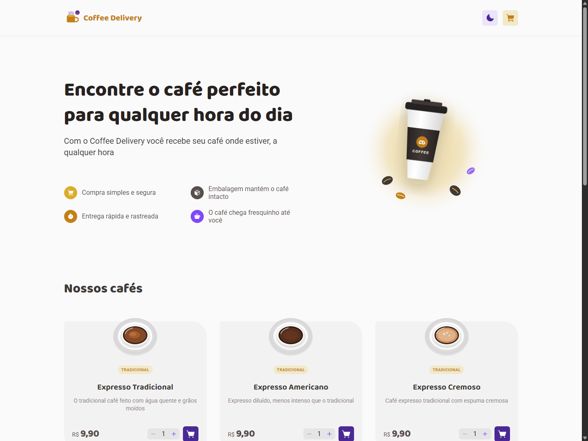
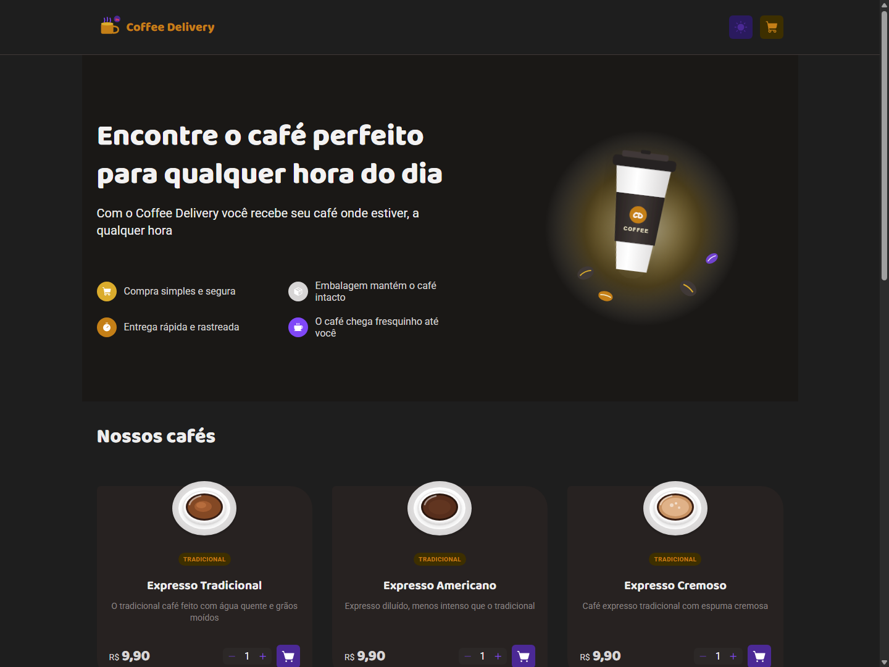
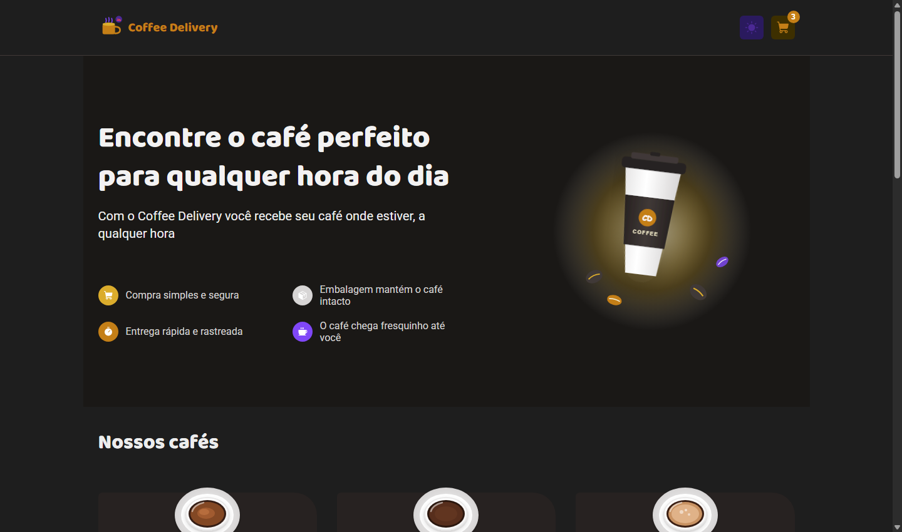
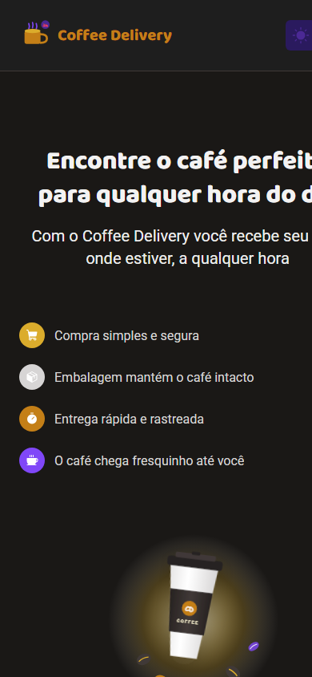

<div align="center">


# ☕ Coffee Delivery

**E-commerce de cafeteria fictícia — Projeto Final da Disciplina de Single Page Application (SPA)**

[](https://react.dev)
[](https://typescriptlang.org)
[](https://vitejs.dev)
[](LICENSE)

[🎨 Protótipo no Figma](https://www.figma.com/design/yGPNTA0Yczb183EikXGIiA/Coffee-Delivery-%E2%80%A2-Projeto-Final-React?node-id=2-1297) · [📄 Especificações](#-documentação-obrigatória) · [📱 Evidências / Screenshots](#-evidências-das-telas-principais)

</div>

---

## 📋 Sobre o Projeto

O **Coffee Delivery** é uma aplicação web completa de e-commerce desenvolvida como projeto final avaliativo da disciplina de **Single Page Application (SPA)**. A aplicação segue fielmente o design system e fluxo de usuário projetados no Figma, oferecendo uma experiência moderna de compra de café.

O usuário pode explorar um catálogo com 14 tipos de cafés especiais, ajustar quantidades, gerenciar o carrinho com persistência local, preencher dados de entrega com validação em tempo real, escolher a forma de pagamento e receber a confirmação visual do pedido.

---

## ✨ Funcionalidades Principais

- ☕ **Catálogo de Cafés Completo**: 14 opções categorizadas (Tradicional, Com Leite, Especial, Alcoólico, Gelado) com descrições, tags visuais e preços formatados em moeda brasileira (R$).
- 🛒 **Carrinho Reativo**: Adição dinâmica com controle de quantidade (+/-) no card e no checkout, remoção de itens e contagem em tempo real na badge do cabeçalho.
- 💾 **Persistência com LocalStorage**: O estado do carrinho e o último pedido são persistidos automaticamente no navegador, sobrevivendo ao recarregamento da página.
- 📝 **Checkout Validado**: Formulário de endereço completo (CEP, rua, número, complemento, bairro, cidade, UF) validado com **React Hook Form** e schemas rigorosos do **Zod**.
- 💳 **Formas de Pagamento**: Seleção intuitiva entre Cartão de Crédito, Cartão de Débito e Dinheiro na entrega.
- 🎉 **Página de Confirmação (Success)**: Apresenta resumo dos dados de entrega, previsão de tempo e forma de pagamento, com proteção de rota (redireciona para home se não houver pedido ativo).
- 🌓 **Dark Mode & Light Mode**: Alternância de tema com variáveis CSS no seletor `[data-theme="dark"]`, persistência da preferência e detecção automática de `prefers-color-scheme`.
- 📱 **Design 100% Responsivo**: Layout otimizado para Mobile (320px–480px), Tablet (768px), Laptop (1024px) e Desktop (1440px).
- 🤖 **Identidade Visual com IA**: Logo original em SVG criada com auxílio de Inteligência Artificial, ilustrações exclusivas e iconografia Phosphor Icons.

---

## 📱 Evidências das Telas Principais

### 1. Home — Catálogo & Hero (Light Mode vs Dark Mode)

| ☀️ Tema Claro (Light Mode) | 🌙 Tema Escuro (Dark Mode) |
|:---:|:---:|
|  |  |

---

### 2. Checkout & Confirmação do Pedido

| 🛒 Carrinho & Formulário de Entrega | 🎉 Pedido Confirmado (Success) |
|:---:|:---:|
|  |  |

---

### 3. Responsividade Mobile

<div align="center">
  
  <p><em>Visualização adaptada para telas móveis (390px)</em></p>
</div>

---

## 🛠️ Stack Tecnológica

| Tecnologia | Versão | Função no Projeto |
|------------|--------|-------------------|
| **React** | 18.3 | Biblioteca base para construção da interface declarativa |
| **TypeScript** | 5.4 | Tipagem estática rigorosa para componentes, contextos e reducers |
| **Vite** | 5.4 | Bundler de alta performance e servidor de desenvolvimento |
| **React Router DOM** | 6.23 | Gerenciamento de rotas SPA (`/`, `/checkout`, `/success`) |
| **React Hook Form** | 7.51 | Controle de formulários com performance otimizada sem re-renders desnecessários |
| **Zod** | 3.23 | Schema validation e inferência de tipos para o formulário de entrega |
| **@hookform/resolvers** | 3.3 | Integração entre Zod e React Hook Form |
| **@phosphor-icons/react** | 2.1 | Conjunto visual de ícones SVG consistentes |
| **CSS Modules** | Nativo | Estilização com escopo local, evitando vazamento de classes |
| **Context API + useReducer** | Nativo | Gerenciamento de estado global previsível (ações tipadas) |

---

## 📁 Estrutura de Diretórios

```
coffee-delivery/
├── public/                       # Assets estáticos servidos diretamente
│   ├── logo.svg                  # Logotipo Coffee Delivery (criado com IA)
│   ├── hero-coffee.svg           # Ilustração do copo no banner hero
│   ├── success-delivery.svg      # Ilustração do entregador na página de sucesso
│   └── images/coffees/           # Vetores SVG dos 14 tipos de cafés
├── src/
│   ├── components/               # Componentes reutilizáveis
│   │   ├── CoffeeCard/           # Card individual do café no catálogo
│   │   ├── Header/               # Topbar fixa com logo, tema e carrinho
│   │   └── QuantityControl/      # Contador numérico reutilizável (-/+)
│   ├── contexts/                 # Provedores de estado global
│   │   ├── CartContext.tsx       # Gerenciamento do carrinho e pedido
│   │   └── ThemeContext.tsx      # Gerenciamento do tema Light/Dark
│   ├── data/                     # Catálogo estático dos cafés
│   │   └── coffees.ts
│   ├── layouts/                  # Layout padrão com Header fixo
│   │   └── DefaultLayout/
│   ├── pages/                    # Páginas da aplicação
│   │   ├── Home/                 # Banner hero + Grade de produtos
│   │   ├── Checkout/             # Formulário de endereço, pagamento e resumo
│   │   └── Success/              # Confirmação do pedido enviado
│   ├── reducers/                 # Lógica de redução de estado (actions tipadas)
│   │   └── cartReducer.ts
│   ├── styles/                   # Estilos globais e tokens CSS
│   │   └── global.css            # Variáveis de cores, fontes e reset
│   ├── types/                    # Definições TypeScript
│   │   └── coffee.ts
│   ├── utils/                    # Funções utilitárias
│   │   └── formatCurrency.ts
│   ├── App.tsx                   # Roteamento da aplicação
│   └── main.tsx                  # Ponto de entrada com Providers
├── docs/
│   └── screenshots/              # Evidências fotográficas da aplicação
├── PRD_SPEC.md                   # Requisitos do Produto
├── TECH_SPEC.md                  # Especificação Técnica da Arquitetura
├── TASKS_SPEC.md                 # Planejamento e Checklist de Tarefas
├── AGENTS.md                     # Diretrizes de Uso de IA
└── README.md                     # Apresentação do projeto
```

---

## 🚀 Como Executar o Projeto

### Pré-requisitos
- **Node.js** (versão 18.x ou superior recomendada)
- **npm** (versão 9.x ou superior) ou **pnpm**

### Passo a passo

1. **Clone o repositório:**
   ```bash
   git clone https://github.com/seu-usuario/coffee-delivery.git
   cd coffee-delivery
   ```

2. **Instale as dependências:**
   ```bash
   npm install
   ```

3. **Inicie o servidor de desenvolvimento:**
   ```bash
   npm run dev
   ```
   Acesse a aplicação no navegador em `http://localhost:5173`.

4. **Gerar build de produção:**
   ```bash
   npm run build
   ```

5. **Visualizar build de produção localmente:**
   ```bash
   npm run preview
   ```

---

## 📄 Documentação Obrigatória

| Documento | Descrição |
|-----------|-----------|
| [**PRD_SPEC.md**](PRD_SPEC.md) | Documento de Requisitos do Produto: objetivos, personas, requisitos funcionais (RF), requisitos não-funcionais (RNF), regras de negócio (RN) e critérios de aceite. |
| [**TECH_SPEC.md**](TECH_SPEC.md) | Especificação Técnica: arquitetura de software, fluxo de dados, gerenciamento de estado via useReducer, validações com Zod, tokens CSS e estratégia de testes. |
| [**TASKS_SPEC.md**](TASKS_SPEC.md) | Planejamento de implementação dividido em 12 fases com acompanhamento detalhado de tarefas concluídas. |
| [**AGENTS.md**](AGENTS.md) | Diretrizes e registro transparente do uso de Inteligência Artificial durante todas as etapas do desenvolvimento do projeto. |

---

## 🤖 Uso de Inteligência Artificial

Conforme as diretrizes da disciplina, este projeto utilizou o assistente de IA **Antigravity (powered by Google DeepMind)** como ferramenta de apoio em:
1. **Planejamento e Arquitetura**: Definição da divisão em `Context API + useReducer` sem bibliotecas externas pesadas.
2. **Implementação de Código**: Tipagem discriminada de actions do reducer, integração do Zod com React Hook Form e tokens para o Dark Mode.
3. **Identidade Visual**: Criação do logotipo original em vetor SVG e ilustrações temáticas.
4. **Documentação Técnica**: Elaboração das especificações completas (PRD, TECH, TASKS e AGENTS).

Para maiores detalhes e diretrizes éticas aplicadas, consulte o [AGENTS.md](AGENTS.md).

---

## 👨‍💻 Autor

Projeto desenvolvido como **Projeto Final Avaliativo** da disciplina de **Single Page Application (SPA)**.  
Ano: 2026

---

<div align="center">
  <sub>Desenvolvido com ☕ e TypeScript</sub>
</div>
