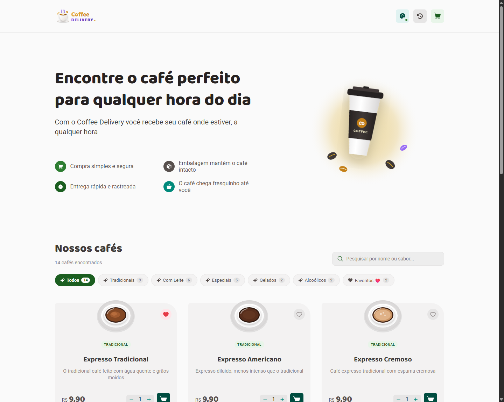
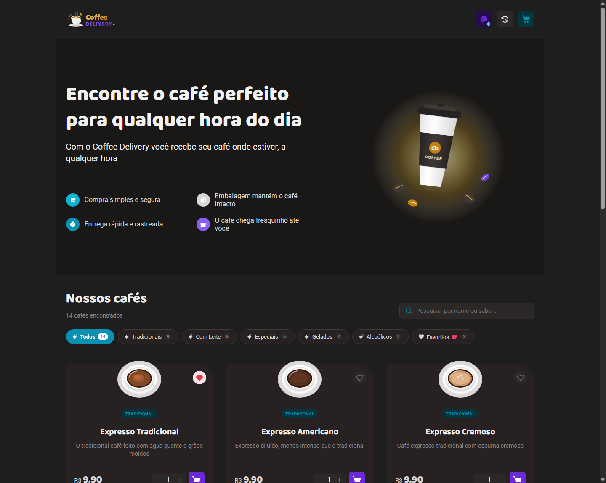
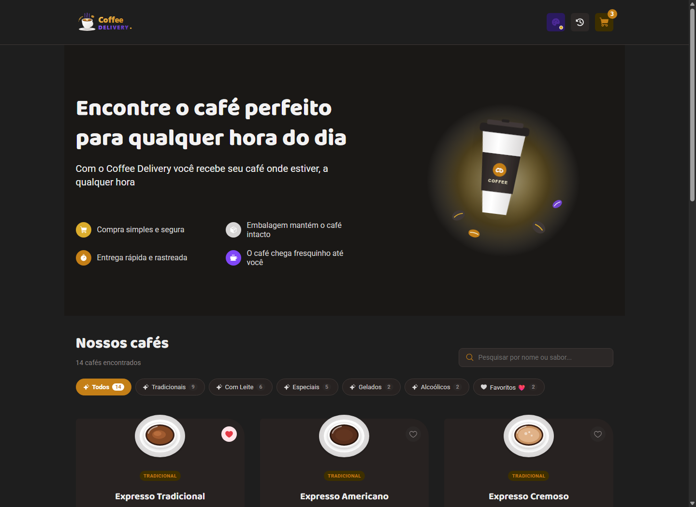

<div align="center">


# ☕ Coffee Delivery

**E-commerce de cafeteria fictícia — Projeto Final da Disciplina de Single Page Application (SPA)**

[](https://react.dev)
[](https://typescriptlang.org)
[](https://vitejs.dev)
[](LICENSE)

[🎨 Protótipo no Figma](https://www.figma.com/design/yGPNTA0Yczb183EikXGIiA/Coffee-Delivery-%E2%80%A2-Projeto-Final-React?node-id=2-1297) · [📄 Especificações](#-documentação-obrigatória) · [📱 Evidências / Screenshots](#-evidências-das-telas-principais)

</div>

---

## 📋 Sobre o Projeto

O **Coffee Delivery** é uma aplicação web completa de e-commerce desenvolvida como projeto final avaliativo da disciplina de **Single Page Application (SPA)**. A aplicação vai além dos requisitos básicos do protótipo do Figma, incorporando recursos avançados de usabilidade, personalização visual e arquitetura de software moderna.

O usuário pode explorar um catálogo com 14 tipos de cafés especiais, filtrar por categorias, pesquisar em tempo real, favoritar cafés, personalizar temas e paletas de cores, gerenciar o carrinho com persistência local, preencher dados de entrega com autocompletar de CEP, aplicar cupons de desconto, visualizar histórico de pedidos e receber confirmação visual em tempo real com notificações Toast.

---

## 🌟 Diferenciais e Melhorias Exclusivas (Além da Documentação)

Para elevar a qualidade do projeto a um padrão profissional de mercado, foram implementadas as seguintes melhorias:

1. 🎨 **Sistema Multi-Temas com 5 Paletas de Cores Exclusivas**:
   - Seletor popover interativo no cabeçalho com pré-visualização de cores.
   - Alternância independente entre **Modo Claro** e **Modo Escuro**.
   - 5 paletas de destaque que adaptam dinamicamente toda a interface via CSS Variables:
     - ☕ **Clássico Coffee**: Amarelo Ouro + Roxo Real
     - 🍵 **Matcha & Menta**: Verde Esmeralda + Menta Floresta
     - 🍓 **Frutas Vermelhas**: Rosa Rubi + Coral Quente
     - 🍯 **Caramelo & Avelã**: Âmbar Caramelo + Mocha Quente
     - ⚡ **Cyber & Neon**: Ciano Elétrico + Violeta Neon
2. 🔍 **Barra de Pesquisa Instantânea**:
   - Busca em tempo real por nome do café, descrição ou tags com botão para limpar busca.
3. 🏷️ **Chips de Filtro por Categoria**:
   - Filtros rápidos: *Todos (14)*, *Tradicionais*, *Com Leite*, *Especiais*, *Gelados*, *Alcoólicos* e *Favoritos ❤️*.
4. ❤️ **Sistema de Favoritos (Wishlist)**:
   - Botão de coração em cada card para favoritar cafés, persistido no `localStorage`.
5. 📍 **Autocompletar de Endereço via API ViaCEP**:
   - Ao digitar os 8 números do CEP no checkout, a aplicação consulta a API ViaCEP e preenche automaticamente rua, bairro, cidade e UF com feedback de carregamento.
6. 🎟️ **Sistema de Cupons de Desconto**:
   - Cupons funcionais: `COFFEE10` (10% de desconto no total) e `FRETEGRATIS` (isenção da taxa de entrega).
   - Validação com feedback instantâneo, exibição do desconto discriminado e recálculo do total.
7. 📜 **Histórico de Pedidos ("Meus Pedidos")**:
   - Modal acessível pelo cabeçalho exibindo todos os pedidos anteriores salvos no navegador, com data, itens, status e opção de limpar histórico.
8. 🍞 **Notificações Toast Animadas**:
   - Feedback visual ao adicionar itens ao carrinho com botão de ação rápida "Ver Carrinho" e auto-dismiss em 3,5 segundos.

---

## ✨ Funcionalidades Core

- ☕ **Catálogo Completo**: 14 cafés com nome, descrição, tags visuais, preço formatado (R$) e ilustrações vetoriais SVG de alta resolução.
- 🛒 **Carrinho Reativo**: Controle numérico de quantidade (+/-), badge no cabeçalho em tempo real e remoção de itens.
- 💾 **Persistência com LocalStorage**: Carrinho, pedidos, histórico, favoritos, modo de tema e paleta de cores persistem no navegador.
- 📝 **Checkout Validado**: Validação rigorosa com **React Hook Form** + schemas **Zod** com mensagens de erro por campo.
- 💳 **Formas de Pagamento**: Seleção visual entre Cartão de Crédito, Débito e Dinheiro na entrega.
- 🎉 **Confirmação (Success)**: Resumo da entrega com previsão de tempo e proteção de rota.
- 📱 **Design 100% Responsivo**: Mobile (320px–480px), Tablet (768px), Laptop (1024px) e Desktop (1440px).

---

## 📱 Evidências das Telas Principais

### 1. Home — Catálogo & Hero (Light Mode vs Dark Mode)

| ☀️ Tema Claro — Clássico Coffee | 🌙 Tema Escuro — Clássico Coffee |
|:---:|:---:|
|  |  |

---

### 2. Paletas de Cores Personalizadas (Novos Temas)

| 🍵 Paleta Matcha & Menta (Light) | ⚡ Paleta Cyber & Neon (Dark) |
|:---:|:---:|
|  |  |

---

### 3. Checkout (com Cupom & ViaCEP) & Confirmação do Pedido

| 🛒 Carrinho, Cupom & Entrega | 🎉 Pedido Confirmado (Success) |
|:---:|:---:|
|  |  |

---

### 4. Responsividade Mobile

<div align="center">
  
  <p><em>Visualização adaptada para telas móveis (390px)</em></p>
</div>

---

## 🛠️ Stack Tecnológica

| Tecnologia | Versão | Função no Projeto |
|------------|--------|-------------------|
| **React** | 18.3 | Biblioteca base para construção da interface declarativa |
| **TypeScript** | 5.4 | Tipagem estática rigorosa para componentes, contextos e reducers |
| **Vite** | 5.4 | Bundler de alta performance e servidor de desenvolvimento |
| **React Router DOM** | 6.23 | Gerenciamento de rotas SPA (`/`, `/checkout`, `/success`) |
| **React Hook Form** | 7.51 | Controle de formulários com performance otimizada sem re-renders desnecessários |
| **Zod** | 3.23 | Schema validation e inferência de tipos para o formulário de entrega |
| **@hookform/resolvers** | 3.3 | Integração entre Zod e React Hook Form |
| **@phosphor-icons/react** | 2.1 | Conjunto visual de ícones SVG consistentes |
| **CSS Modules** | Nativo | Estilização com escopo local, evitando vazamento de classes |
| **Context API + useReducer** | Nativo | Gerenciamento de estado global previsível (ações tipadas) |
| **API ViaCEP** | Externa | Consulta em tempo real de logradouro via CEP brasileiro |

---

## 📁 Estrutura de Diretórios

```
coffee-delivery/
├── public/                       # Assets estáticos servidos diretamente
│   ├── logo.svg                  # Logotipo Coffee Delivery (criado com IA)
│   ├── hero-coffee.svg           # Ilustração do copo no banner hero
│   ├── success-delivery.svg      # Ilustração do entregador na página de sucesso
│   └── images/coffees/           # Vetores SVG dos 14 tipos de cafés
├── src/
│   ├── components/               # Componentes reutilizáveis
│   │   ├── CoffeeCard/           # Card individual do café (com botão favoritar)
│   │   ├── Header/               # Topbar com logo, temas, histórico e carrinho
│   │   ├── OrdersModal/          # Modal de histórico "Meus Pedidos"
│   │   ├── QuantityControl/      # Contador numérico reutilizável (-/+)
│   │   └── ThemeSelector/        # Seletor popover de paletas e tema Light/Dark
│   ├── contexts/                 # Provedores de estado global
│   │   ├── CartContext.tsx       # Carrinho, cupons, favoritos e pedidos
│   │   ├── ThemeContext.tsx      # Modo Light/Dark e 5 paletas de cores
│   │   └── ToastContext.tsx      # Sistema de notificações Toast animadas
│   ├── data/                     # Catálogo estático dos cafés
│   │   └── coffees.ts
│   ├── layouts/                  # Layout padrão com Header fixo
│   │   └── DefaultLayout/
│   ├── pages/                    # Páginas da aplicação
│   │   ├── Home/                 # Hero + Busca + Filtros + Grade de produtos
│   │   ├── Checkout/             # Formulário ViaCEP + Cupons + Resumo
│   │   └── Success/              # Confirmação do pedido enviado
│   ├── reducers/                 # Lógica de redução de estado (actions tipadas)
│   │   └── cartReducer.ts
│   ├── styles/                   # Estilos globais e tokens CSS
│   │   └── global.css            # Variáveis de cores das 5 paletas e reset
│   ├── types/                    # Definições TypeScript
│   │   └── coffee.ts
│   ├── utils/                    # Funções utilitárias
│   │   └── formatCurrency.ts
│   ├── App.tsx                   # Roteamento da aplicação
│   └── main.tsx                  # Ponto de entrada com Providers
├── docs/
│   └── screenshots/              # Evidências visuais de todas as telas e temas
├── PRD_SPEC.md                   # Requisitos do Produto
├── TECH_SPEC.md                  # Especificação Técnica da Arquitetura
├── TASKS_SPEC.md                 # Planejamento e Checklist de Tarefas
├── AGENTS.md                     # Diretrizes de Uso de IA
└── README.md                     # Apresentação do projeto
```

---

## 🚀 Como Executar o Projeto

### Pré-requisitos
- **Node.js** (versão 18.x ou superior)
- **npm** (versão 9.x ou superior)

### Passo a passo

1. **Instale as dependências:**
   ```bash
   npm install
   ```

2. **Inicie o servidor de desenvolvimento:**
   ```bash
   npm run dev
   ```
   Acesse a aplicação no navegador em `http://localhost:5173`.

3. **Gerar build de produção:**
   ```bash
   npm run build
   ```

4. **Visualizar build de produção localmente:**
   ```bash
   npm run preview
   ```

---

## 📄 Documentação Obrigatória

| Documento | Descrição |
|-----------|-----------|
| [**PRD_SPEC.md**](PRD_SPEC.md) | Documento de Requisitos do Produto: objetivos, personas, requisitos funcionais (RF), requisitos não-funcionais (RNF), regras de negócio (RN) e critérios de aceite. |
| [**TECH_SPEC.md**](TECH_SPEC.md) | Especificação Técnica: arquitetura de software, fluxo de dados, gerenciamento de estado via useReducer, validações com Zod, tokens CSS e estratégia de testes. |
| [**TASKS_SPEC.md**](TASKS_SPEC.md) | Planejamento de implementação dividido em 13 fases com acompanhamento detalhado de tarefas concluídas. |
| [**AGENTS.md**](AGENTS.md) | Diretrizes e registro transparente do uso de Inteligência Artificial durante todas as etapas do desenvolvimento do projeto. |

---

## 🤖 Uso de Inteligência Artificial

Conforme as diretrizes da disciplina, este projeto utilizou o assistente de IA **Antigravity (powered by Google DeepMind)** como ferramenta de apoio em:
1. **Planejamento e Arquitetura**: Definição da divisão em `Context API + useReducer` sem bibliotecas externas pesadas e concepção das paletas de cores.
2. **Implementação de Código**: Tipagem discriminada de actions do reducer, integração do Zod com React Hook Form, API ViaCEP e tokens dinâmicos para os temas.
3. **Identidade Visual**: Criação do logotipo original em vetor SVG e ilustrações temáticas.
4. **Documentação Técnica**: Elaboração das especificações completas (PRD, TECH, TASKS e AGENTS).

Para maiores detalhes e diretrizes éticas aplicadas, consulte o [AGENTS.md](AGENTS.md).

---

## 👨‍💻 Autor

Projeto desenvolvido como **Projeto Final Avaliativo** da disciplina de **Single Page Application (SPA)**.  
Ano: 2026

---

<div align="center">
  <sub>Desenvolvido com ☕ e TypeScript</sub>
</div>
